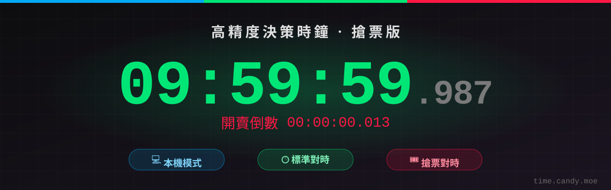

<p align="center">
  
</p>

<p align="center">
  <a href="https://time.candy.moe"><b>👉 立即使用：time.candy.moe</b></a>
</p>

<p align="center">
  
  
  
  <a href="https://github.com/candy999/clock-worker-API"></a>
</p>

# 高精度決策時鐘（搶票版）

**一個對準「售票網站伺服器時間」的毫秒級時鐘。**

搶票、搶購的關鍵不是你手機上的時間，而是**售票網站伺服器認定的時間**。你的裝置可能慢了 0.3 秒，售票網站的伺服器又可能快了 0.4 秒——加起來就是 0.7 秒的落差，足以決定搶不搶得到。

高精度決策時鐘會：

- 把你的裝置時間校正到 Cloudflare 的標準時鐘（與 NTP 同步）；
- 再透過 [clock-worker-API](https://github.com/candy999/clock-worker-API) 量出**目標售票網站自己的時鐘**跟標準時間差多少；
- 最後顯示「售票網站眼中的現在幾點」，精確到毫秒，並附上估計精度 ±ms。

整個前端只有一個 `index.html`，不需要建置、不需要框架，丟上任何靜態主機就能用。

## 目錄

- [功能](#功能)
- [三種模式](#三種模式)
- [使用方式](#使用方式)
- [支援的網站捷徑](#支援的網站捷徑)
- [專案結構](#專案結構)
- [部署到 Cloudflare Pages](#部署到-cloudflare-pages)
- [本機開發](#本機開發)
- [隱私](#隱私)
- [更新紀錄](#更新紀錄)

## 功能

| | 功能 | 說明 |
|---|---|---|
| ⏱ | **毫秒時鐘** | 顯示到毫秒，並依螢幕刷新率做顯示補償（畫面上的數字就是「下一次螢幕刷新那一刻」的時間）。 |
| 🎟️ | **售票網站對時** | 量出售票網站伺服器時鐘的偏差，不只是「標準時間」。 |
| ⏳ | **開賣倒數** | 填入開賣時間，倒數到毫秒；最後 10 秒自動再快速對時一次。 |
| 🌏 | **跨國時區** | 日本、韓國、香港、東南亞各國時區，選了之後直接填當地開賣時間。 |
| 🚀 | **自動跳轉** | 時間到自動跳到售票頁，會依「到售票網站的實際延遲」提前送出。 |
| 📺 | **懸浮時鐘（畫中畫）** | 桌機用 Document PiP；手機用預錄影片畫中畫，切到別的 App 也看得到。 |
| 🔖 | **售票頁懸浮時鐘** | 書籤小工具，直接在售票頁上疊一個校正後的時鐘，時間到在該頁重新整理（連線已暖好，最快）。 |
| 💾 | **記住設定** | 網址、時區、開賣時間、手動微調存在你自己的瀏覽器。 |

## 三種模式

| 模式 | 時間來源 | 適合 | 消耗 API |
|---|---|---|---|
| 💻 **本機** | 你裝置的系統時間 | 只想看毫秒時鐘 | 不會 |
| 🕒 **標準** | Cloudflare 標準時鐘（`/api/time`） | 需要準確的標準時間 | 每次對時約 8 個請求 |
| 🎟️ **搶票** | 標準時鐘 ＋ 售票網站的時鐘偏差（`/api/proxy-time`） | 搶票、搶購 | 每次對時約 8 秒 |

搶票模式的計算方式：

```
售票網站時間 = 本機時間 + (Worker − 本機) + (售票網站 − Worker)
                          └─ 前端量 ─┘     └─ API 秒邊界夾擠法量 ─┘
```

**本機 ↔ Worker** 的量法：先暖機一次（丟掉含 DNS／TCP／TLS 握手的那筆），再取樣 8 次，取 RTT 最小三筆的偏移中位數；瀏覽器支援時用 Resource Timing 扣掉排隊與握手時間。時基使用 `performance.timeOrigin + performance.now()`，不受系統自動校時跳動影響。

## 使用方式

1. 打開 [time.candy.moe](https://time.candy.moe)，切到 **🎟️ 搶票**。
2. 在下拉選單選售票網站（或直接輸入任何網址，只打 `shopee.tw` 這種網域也可以）。
3. 填入**開賣時間**；海外場次在旁邊選該國時區，例如日本 10:00 開賣就選「日本時間」填 10:00。
4. 按 **🔄 手動同步時間**，等約 8 秒，資訊面板會顯示偏差與估計精度。
5. 選一個方式盯時間：
   - **售票頁懸浮時鐘（推薦）**：把紫色的「⏱ 售票頁時鐘」按鈕拖到書籤列，到售票頁點一下就會出現時鐘。手機請按「複製程式碼」，建一個書籤把網址換成剛複製的內容（頁面上有詳細步驟）。
   - **畫中畫**：按「開啟畫中畫」，時鐘會浮在所有視窗上方。
   - **自動跳轉**：勾選「倒數自動跳轉」，時間到這個分頁會自己跳到售票頁。
6. 覺得自己的網路特別慢或快，可以用 **手動微調（毫秒）** 再加減。

> **iOS 使用者**：畫中畫請在 Safari 裡直接開，不要從「加入主畫面」的捷徑開（WebKit bug 303885）。

## 支援的網站捷徑

下拉選單只是捷徑，**任何網址都能用**。

| 地區 | 網站 |
|---|---|
| 🇹🇼 台灣售票 | 拓元 tixcraft、KKTIX、ibon 售票、遠大 ticketplus、年代售票、寬宏售票、全家 FamiTicket、OPENTIX 兩廳院 |
| 🇯🇵 日本售票 | e+ イープラス、ローチケ、チケットぴあ、楽天チケット |
| 🇰🇷 韓國售票 | NOL 인터파크 티켓、멜론티켓、YES24 티켓、티켓링크 |
| 🇭🇰 香港 | Cityline |
| 🛒 購物搶購 | 蝦皮（台灣、新加坡、馬來西亞、菲律賓、泰國、越南、印尼）、momo 購物、PChome 24h |

如果某個網站顯示「回應都來自快取，無法量測」，代表它的首頁是 CDN 快取的靜態頁，請改填它購票流程或 API 用的網域。

## 專案結構

```
clock-worker-frontend/
├── index.html               # 整個應用程式（HTML + CSS + JS）
├── vendor/
│   ├── mp4-muxer.mjs        # 手機畫中畫影片封裝用（MIT，只在需要時才動態載入）
│   └── mp4-muxer.LICENSE
└── .github/
    └── banner.svg           # README 橫幅
```

部署時 `index.html` 與 `vendor/` **兩個都要上傳**。

## 部署到 Cloudflare Pages

> **順序：先部署 [clock-worker-API](https://github.com/candy999/clock-worker-API#部署到-cloudflare)，再部署前端。** 前端需要 API 回傳的 `offset` 欄位。

### 0. 如果是部署你自己的版本：改 API 位址

`index.html` 裡寫死了 API 位址：

```js
const API_BASE = 'https://api.time.candy.moe';
```

改成你自己部署的 Worker 網址，並記得在 API 的 `ALLOWED_ORIGINS` 加上你的前端網域（例如 `https://你的專案.pages.dev`），否則搶票模式會被 CORS 擋下。

### 方法 A：連結 GitHub 自動部署（推薦）

1. Cloudflare Dashboard → **Workers & Pages → Create → Pages → Connect to Git**。
2. 選擇 `clock-worker-frontend` 這個 repo，Production branch 選 `main`。
3. Build 設定：
   - **Framework preset**：`None`
   - **Build command**：留空
   - **Build output directory**：`/`
4. 按 **Save and Deploy**，完成後會得到 `https://<專案名稱>.pages.dev`。
5. 之後每次推到 `main` 都會自動部署；推到其他分支會產生預覽網址。

### 方法 B：用 Wrangler CLI 直接上傳

```bash
git clone https://github.com/candy999/clock-worker-frontend.git
```

```bash
cd clock-worker-frontend
```

```bash
npx wrangler login
```

```bash
npx wrangler pages deploy . --project-name=clock-worker-frontend --branch=main
```

第一次執行會自動建立 Pages 專案。

### 綁定自訂網域

Pages 專案 → **Custom domains → Set up a custom domain** → 輸入 `time.candy.moe`（或你的網域）。網域在 Cloudflare 託管時，DNS 紀錄與 HTTPS 憑證會自動建立。

### 部署後檢查

- 打開網站，切到 **🕒 標準**，按同步，資訊面板應出現「網路延遲」與「估計精度」。
- 切到 **🎟️ 搶票**，選任一網站同步；若出現「API 版本太舊，請重新部署 clock-worker-API」，代表後端還是舊版。
- 若出現 CORS 錯誤，檢查 API 的 `ALLOWED_ORIGINS` 是否包含目前的網域。

## 本機開發

不需要安裝任何套件，起一個靜態伺服器即可（`vendor/mp4-muxer.mjs` 是 ES module，不能直接用 `file://` 開）：

```bash
python3 -m http.server 8000
```

然後打開 `http://localhost:8000`。API 對 `localhost` 已經開放 CORS，所以本機頁面可以直接呼叫線上 API；若要連本機的 Worker，把 `API_BASE` 暫時改成 `http://localhost:8787`，並在 API 專案執行 `npm run dev`。

## 隱私

- 設定只存在你自己瀏覽器的 `localStorage`（鍵名 `tc-settings`），不會上傳。
- 前端只會呼叫 clock-api 的兩個端點，以及對目標網站送不帶憑證的連線測速請求。
- 沒有追蹤、沒有分析、沒有 Cookie。

## 更新紀錄

### 2026-10

**對時**
- 先暖機一次（丟掉含 DNS／TCP／TLS 握手的那筆），再取樣 8 次，取 RTT 最小三筆的 offset 中位數。
- API 有 `Timing-Allow-Origin` 時，改用 Resource Timing 的 `requestStart`／`responseStart` 算 RTT。
- 時基改用 `performance.timeOrigin + performance.now()`，不受系統自動校時跳動影響；偵測到電腦睡眠或系統時間大跳動會提示重新對時。
- 搶票模式 = 本機↔Worker 的差 ＋ Worker↔售票站的差（後者由 API 的秒邊界夾擠法量出），並顯示估計精度 ±ms。
- 最後 10 秒的自動對時改成「快速對時」：只重量本機↔Worker（約 0.5 秒），售票站的差沿用。

**網址與時區**
- 網址欄可以填任何網址（只打網域也行）。上方的下拉選單是常用網站捷徑：台灣、日本、韓國售票、香港 Cityline、蝦皮各國站、momo、PChome。選了會幫你填網址與時區，填完仍可自由修改；手動改網址時選單自動切回「自訂」。
- 開賣時間旁邊可以選時區（日本、韓國、東南亞各國）。選了之後時鐘、倒數、懸浮時鐘、書籤時鐘都以那個時區顯示。
- 網址、時區、開賣時間、手動微調會記在這台裝置的瀏覽器裡。

**跳轉**
- 提前量改用「到售票網站本身」量到的延遲（冷連線抵達時間），不再用到 Cloudflare 的 RTT。
- 計時放在 Web Worker：分頁在背景時 rAF 會停、`setTimeout` 被節流到 1 秒，Worker 不受影響；最後 2 秒每 2ms 檢查一次。
- 修正跨午夜（例如 00:00:00 開賣）永遠不會觸發的問題。
- 移除 no-cors `favicon` 預連線（不帶憑證，跟頁面導航用不同連線池，用不到），只保留 `<link rel="preconnect">`。

**畫面**
- 「畫面渲染延遲」其實是幀間隔，改名並用來做顯示補償：顯示的是「下一次螢幕刷新時」的時間。
- 新增開賣倒數。

**懸浮時鐘**
- 桌機（Chrome/Edge 116+、Firefox 151+）：Document PiP 自己跑畫面迴圈，不再從主分頁複製內容，主分頁切到背景也不會停。
- 手機（iOS／Android）：預錄影片畫中畫。用 WebCodecs 把接下來 2–10 分鐘的時鐘逐格編成 mp4（每秒一個關鍵幀），交給系統影片播放器播放，切到別的 App 也不會停；播放時用 `requestVideoFrameCallback` 持續校正。
- 新增「售票頁懸浮時鐘」書籤小工具：在售票頁上顯示校正後的時鐘，打開時會自己再對時一次，時間到在售票頁本身重新整理（連線已暖好，比從時鐘頁跳轉快）。

## 授權與致謝

- 手機畫中畫影片封裝使用 [mp4-muxer](https://github.com/Vanilagy/mp4-muxer)（MIT License，© Vanilagy），授權條款見 `vendor/mp4-muxer.LICENSE`。

## 免責聲明

本工具只顯示時間與在時間到時開啟／重新整理網頁，不會替你登入、下單或繞過任何網站的排隊與驗證機制。使用時請遵守各售票與購物網站的服務條款。
